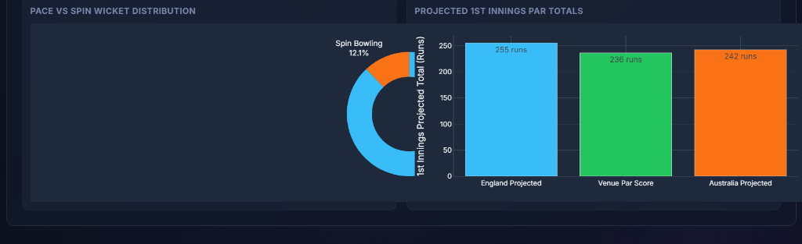
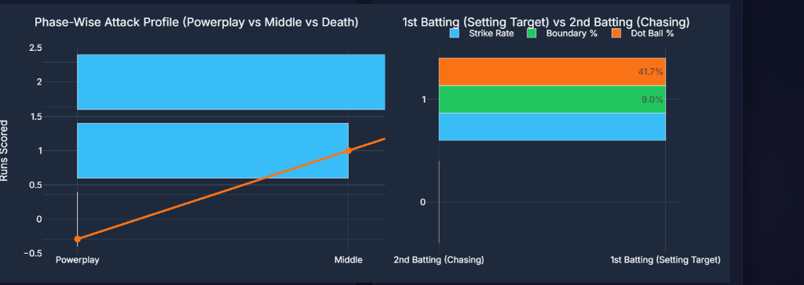
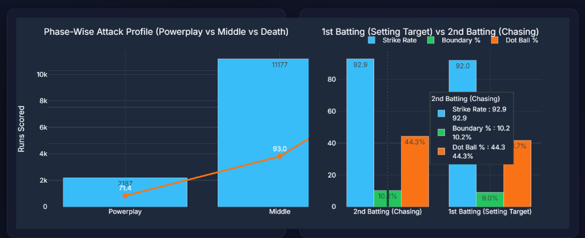
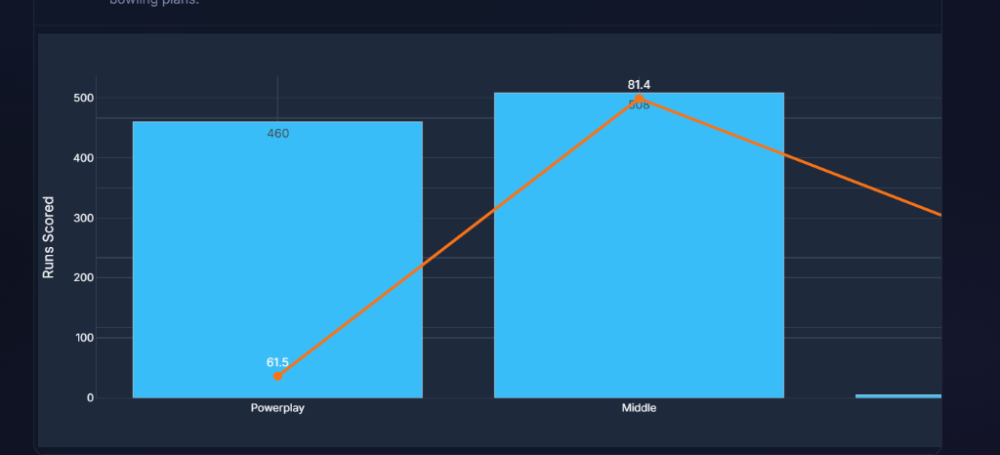
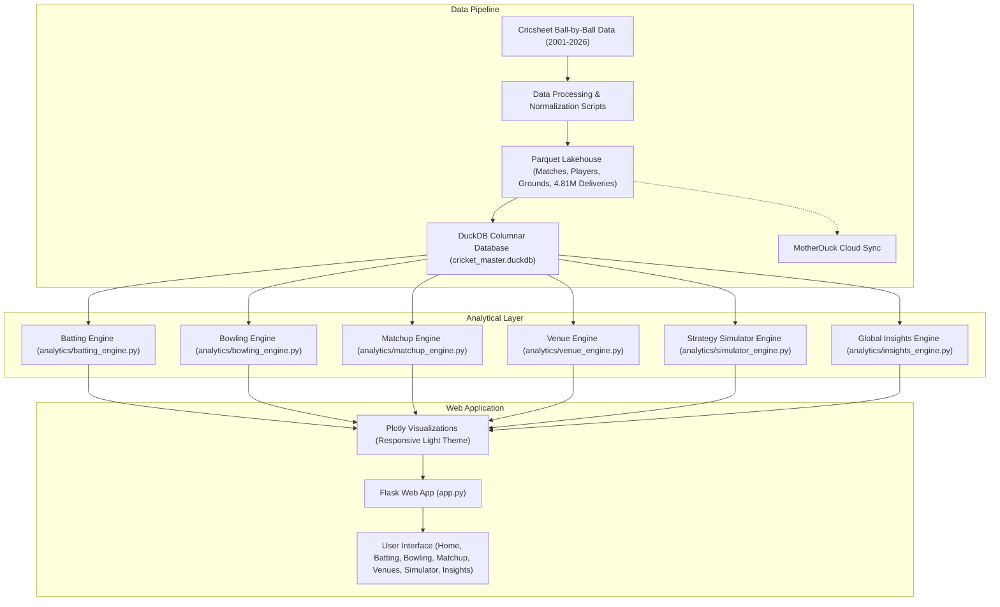

# Cricket Performance and Tactical Intelligence Platform

<p align="center">
  
</p>

A comprehensive Data Science and Cricket Analytics platform built using ball-by-ball data of 4.81 million deliveries across Test, ODI, and T20 International matches from 2001 to 2026.

---

## Project Overview

When looking at cricket analytics projects online, most of them either use very small datasets (like a single tournament or 200k balls from Kaggle) or combine Test, ODI, and T20 stats together into a single average. In real cricket, averaging a Test score of 300 with a T20 score of 160 makes no sense because the rules, field restrictions, and pitch deterioration across 5 days are completely different.

I built this project to create a practical, production-level cricket analytics system that handles international cricket properly:
- Ingests and processes all international matches from Cricsheet (4.81 million ball-by-ball deliveries).
- Uses DuckDB as an embedded columnar database and Parquet storage so queries run in less than a second without needing heavy server clusters.
- Keeps formats strictly separated (Test matches use 4 independent innings, while ODIs and T20Is use phase-wise analysis and target chasing brackets).
- Includes an era-aware Pre-Game Match Simulator where retired players are excluded based on the selected time period, and the Playing XI adapts to pitch conditions (pace vs spin).
- Uses a clean, modern user interface (White background, Black top navigation bar, Orange interactive accents) with instant player search autocompletion across all modules.

---

## Application Preview & Screenshots

Here is a quick walkthrough of the running platform:

### 1. Central Portal & Home Dashboard
Direct navigation cards to all six analytical engines with instant routing.


### 2. Batting Performance & Pitch Zone Engine
Detailed batting encyclopedias: Test 4-innings decay analysis, limited-overs phase attack rates (Powerplay, Middle, Death), pitch zone heatmaps, and dismissal breakdown.


### 3. Tactical Matchup & Duel Dossier
Direct head-to-head confrontation analysis: Batter vs Bowler duels with cumulative strike rate curves, balls faced, dismissal logs, and team attack splits.


### 4. Stadium Pitch Breakdown & Match Simulator
Venue-specific pace vs spin wicket distribution, first innings par score projections, and condition-smart Playing XI selection with era-aware retiree filters.


### 5. Multi-Format Macro Insights & Evolution
Historical scoring tempo (2001-2026), boundary frequency evolution, target chasing success brackets, and top performers across all three international formats.


---

## System Architecture



---

## Project Directory Structure

```text
cricket-strategy-intelligence/
├── app.py                          # Master Flask application, routes & API endpoints
├── Procfile                        # Production WSGI process definition
├── requirements.txt                # Python dependencies
├── .gitignore                      # Git ignore configuration
│
├── analytics/                      # Analytical layer & DuckDB query engines
│   ├── db.py                       # DuckDB connection pooling & lakehouse querying
│   ├── batting_engine.py           # Batting metrics, zone heatmaps, phase & chase splits
│   ├── batting_plots.py            # Batting Plotly figures (format-aware)
│   ├── bowling_engine.py           # Bowling lethality, line & length profiles, phase impact
│   ├── bowling_plots.py            # Bowling Plotly figures
│   ├── matchup_engine.py           # Tactical H2H Batter vs Bowler, Batter vs Team, Bowler vs Team
│   ├── matchup_plots.py            # Head-to-head battle figures & dismissal chronological log
│   ├── venue_engine.py             # Ground profiles, Pace vs Spin splits, home fortresses
│   ├── venue_plots.py              # Stadium pitch breakdown & 4-innings decay curves
│   ├── simulator_engine.py         # Win probability model & condition-smart Playing XI selection
│   ├── simulator_plots.py          # Projected par scores & pitch distribution plots
│   ├── insights_engine.py          # Macro historical evolution (2001-2026) across formats
│   └── insights_plots.py           # Multi-format benchmark matrices & target chasing brackets
│
├── data_pipeline/                  # Ingestion, schema validation & database compilation
│   ├── downloader.py               # Automated Cricsheet JSON archive downloader
│   ├── player_normalizer.py        # Name reconciliation & cross-format disambiguation
│   └── build_lakehouse.py          # DuckDB & Parquet lakehouse compiler
│
├── data/
│   ├── processed/
│   │   ├── cricket_master.duckdb   # Master DuckDB database (4.81M ball-by-ball deliveries)
│   │   ├── dim_matches.parquet     # Match dimensions
│   │   ├── dim_players.parquet     # Player metadata & primary roles
│   │   ├── dim_grounds.parquet     # Ground & venue metadata
│   │   └── fact_deliveries_master.parquet # Compressed columnar fact table
│   └── raw/                        # Cricsheet raw JSON match archives
│
├── templates/                      # Clean light theme templates (White / Black / Orange)
│   ├── base.html                   # Master layout with black navbar & global styles
│   ├── index.html                  # Central portal with direct module access cards
│   ├── batting_analytics.html      # Batting intelligence with custom autocomplete
│   ├── bowling_analytics.html      # Bowling intelligence with custom autocomplete
│   ├── matchup.html                # Tactical matchup engine with duel dossier
│   ├── venue_analytics.html        # Stadium & national team dynamics
│   ├── simulator.html              # Pre-game strategy simulator & Playing XI picker
│   ├── insights.html               # Global multi-format macro analytics & historical curves
│   └── 404.html                    # Error handling page
│
├── static/
│   ├── cricket.jpg                 # Home page banner visual
│   └── css/
│       └── style.css               # Design system: White background, Black top bar, Orange buttons
│
├── docs/                           # Documentation & recruiter showcase assets
│   └── screenshots/                # Application UI previews & figures
│
└── tests/                          # Automated test suites (100% test coverage)
    ├── __init__.py
    ├── test_batting.py             # Batting analytics & format-separation tests
    ├── test_bowling.py             # Bowling lethality & heatmap tests
    ├── test_matchup.py             # Head-to-head & team duel tests
    ├── test_venues.py              # Venue pace vs spin & 4-innings decay tests
    ├── test_simulator.py           # Pre-game simulation & era squad tests
    ├── test_insights.py            # Global macro benchmarks & chasing bracket tests
    ├── test_plotly_encoding.py     # Plotly typed array validation tests
    └── test_find_bdata.py          # Serialization regression tests
```

---

## Key Modules and Features

### 1. Batting Analytics (/batting)
- Format-pure statistics for Test, ODI, and T20I matches.
- For Test cricket: shows innings-wise progression (Innings 1, 2, 3, 4) to understand how the batsman performs on Day 1-2 compared to Day 4-5.
- For ODIs and T20Is: shows phase breakdown across Powerplay (overs 1-6), Middle overs (7-15/40), and Death overs (16-20 / 41-50).
- Pitch line and length heatmaps showing strike rates and dismissal risk.
- Record against different bowling styles (Pace, Off-spin, Leg-spin, Left-arm orthodox) and setting vs chasing targets.
- Dynamic autocomplete dropdown showing popular batsmen on focus and live search matches.

### 2. Bowling Analytics (/bowling)
- Line and length heatmaps showing wicket-taking zones and economy rates.
- Phase-wise bowling impact (Powerplay containment vs Death overs execution).
- Performance breakdown against Left-Handed Batters (LHB) vs Right-Handed Batters (RHB).
- Delivery length analysis (Full, Good Length, Short of Length, Bouncers).
- Dynamic autocomplete dropdown showing popular bowlers on focus and live search matches.

### 3. Tactical Matchup Intelligence (/matchup)
- Head-to-Head Batter vs Bowler duels: direct career ball-by-ball history showing runs scored, balls faced, dismissals, strike rate, and boundary percentage.
- Batter vs Opposition Team: player records against specific national bowling attacks.
- Bowler vs Opposition Team: top victims, bowling average, and strike rate against specific countries.
- Chronological dismissal log detailing date, format, venue, inning, over, and mode of dismissal for every wicket.

### 4. Team and Venue Intelligence (/venues)
- Pace vs Spin wicket distribution: exact split of wickets taken by pacers versus spinners at each ground, along with their respective bowling averages.
- Test pitch deterioration: average runs scored in Innings 1, 2, 3, and 4 at that venue, plus match duration (how many matches finish in 3, 4, or 5 days).
- Home ground advantage: national team win percentages at home venues, average first innings par scores, and toss decision records.

### 5. Pre-Game Strategy and Match Simulator (/simulator)
- Win probability estimation based on venue history, head-to-head records, and toss conditions (batting first vs chasing).
- Condition-Smart Playing XI Selector: auto-picks 11 players with proper team balance (1 Wicketkeeper, 4-5 Batters, 1-2 All-Rounders, 3-4 Bowlers) and adjusts the pace/spin bowling combination based on whether the venue pitch favors pace or spin.
- Era-Aware Player Filtering: allows simulating matches in specific eras (Current Active 2023-2026, 2019 World Cup era, 2015 era, 2011 era, or All-Time). Retired players are filtered out automatically so they do not show up in modern simulations.
- Direct head-to-head battle table between the selected playing XIs.

### 6. Global Cricket Insights and Historical Evolution (/insights)
- Multi-Format Benchmark (Top Section):
  - Side-by-side comparison table of Test, ODI, and T20I (average score, run rate, boundary percentage, dot-ball percentage, wickets per 100 balls).
  - Three-Era Comparison: analyzing how cricket changed between 2000-2009, 2010-2019, and 2020-2026.
  - Batting accumulation: stacked area chart tracking dots, singles, twos, and boundaries over the years.
  - Toss decision conversion rates: win percentage when choosing to bat vs field.
- Format Deep-Dive Selector (Bottom Section):
  - Test Cricket: 4 distinct innings scoring lines, pitch deterioration decay curve, historical decline of Test draws (down from ~30% in 2000 to under 8% today), and 4th innings target chase outcomes.
  - Limited Overs: ODI and T20I target chasing success brackets (<140, 140-169, 170-199, 200+ for T20I; <200, 200-249, 250-299, 300+ for ODI).
  - Top Performers: leading run-scorers and wicket-takers for the selected team in that specific format.

### 7. Search Portal and Home Page (/)
- Direct navigation access to all 6 intelligence modules with clean uniform orange buttons and descriptive cards.

---

## Database Schema

The database is built on DuckDB (`data/processed/cricket_master.duckdb`) and structured into four normalized tables:

### 1. dim_matches
Stores match-level information:
- `match_id` (Primary Key)
- `match_type` (Test, ODI, T20I)
- `match_date` (Date in YYYY-MM-DD)
- `season`, `tournament`
- `team_1`, `team_2`
- `venue`, `city`
- `toss_winner`, `toss_decision` (bat or field)
- `winner`, `win_margin_runs`, `win_margin_wkts`, `outcome_result` (draw, tie, etc.)

### 2. dim_players
Stores player information:
- `player_id`, `player_name`
- `primary_role` (Top-order Batter, Middle-order Batter, Pacer, Spinner, All-Rounder, Wicketkeeper)
- `batting_style` (Right hand bat, Left hand bat)
- `bowling_style`

### 3. dim_grounds
Stores stadium details, ground names, and country mappings.

### 4. fact_deliveries_master (4.81 Million Deliveries)
Stores delivery-level facts:
- `delivery_key` (Primary Key)
- `match_id` (Foreign Key to dim_matches)
- `batting_team`, `bowling_team`
- `inning` (1, 2, 3, 4)
- `over`, `ball`
- `match_phase` (Powerplay, Middle, Death)
- `batter`, `bowler`
- `runs_batter`, `runs_extras`, `total_runs`
- `extra_wides`, `extra_noballs`, `extra_byes`, `extra_legbyes`
- `is_dot`, `is_four`, `is_six`, `is_wicket`
- `dismissal_kind` (bowled, caught, lbw, stumped, run out, etc.)
- `player_out`

---

## Statistical Rules and Cricket Domain Logic

1. Legal Deliveries for Run Rates:
   Run Rate is calculated as:
   Total Runs / (Legal Deliveries / 6.0)
   Wides and no-balls are not counted as legal deliveries in the overs denominator.

2. Bowler Wickets vs Run Outs:
   When calculating bowling averages and strike rates, wickets credited to bowlers only include bowled, caught, lbw, stumped, caught and bowled, and hit wicket. Run outs and retired hurts are excluded from bowling statistics.

3. Format Independence:
   Test matches are never evaluated using limited-overs phases like Powerplay or Death overs. Test scoring is tracked across 4 independent innings.

4. Data Integrity:
   No assumptions or synthetic variables are made for missing fields. Weather or dew factors are not claimed without actual sensor data.

---

## Tech Stack

- Backend: Python 3.13 / 3.12, Flask, Jinja2
- Data Storage and Querying: DuckDB (embedded columnar SQL database), Apache Parquet, MotherDuck
- Data Science Libraries: Pandas, NumPy, Scikit-learn
- Frontend Visualizations: Plotly.js, responsive light-themed HTML/CSS (White, Black, Orange)
- Testing: Pytest

---

## How to Run the Project Locally

### 1. Clone the repository
```bash
git clone https://github.com/Yaswantsai/cricket-strategy-intelligence.git
cd cricket-strategy-intelligence
```

### 2. Set up virtual environment and install dependencies
```bash
python -m venv .venv

# On Windows
.venv\Scripts\activate

# On Mac/Linux
source .venv/bin/activate

# Install required packages
pip install -r requirements.txt
```

### 3. Verify Database
The processed database is stored at `data/processed/cricket_master.duckdb`.
To check table row counts and verify database connectivity:
```bash
python -c "import duckdb; con=duckdb.connect('data/processed/cricket_master.duckdb'); print(con.execute('SELECT COUNT(*) FROM fact_deliveries_master').fetchall())"
```

### 4. Run Automated Tests
To run all test suites from the `tests/` directory:
```bash
pytest tests/ -v
```

### 5. Start the Web Application
```bash
python app.py
```
Open your browser and visit:
`http://127.0.0.1:5000/`

---

## Automated Test Suites

The project includes comprehensive test scripts in `tests/` for verifying data accuracy, route status, and visualization rendering:

- `tests/test_batting.py`: Verifies Test 4-innings display, phase plot suppression in Tests, and chase analytics in limited overs.
- `tests/test_bowling.py`: Verifies bowling economy zones, wicket profiles, style splits, and Plotly array rendering.
- `tests/test_matchup.py`: Verifies Batter vs Bowler duels, Batter vs Team, and Bowler vs Team modes.
- `tests/test_venues.py`: Verifies Pace vs Spin wicket distribution, 4-innings decay curves, and venue fortress records.
- `tests/test_simulator.py`: Verifies playing XI balance, condition adaptation, and era-based retiree exclusion.
- `tests/test_insights.py`: Verifies format comparison matrices, 4-innings Test trends, target chasing brackets, and top performers.
- `tests/test_plotly_encoding.py`: Verifies zero typed-array serialization bugs across all generated figures.

---

## Author

- Yaswant Sai Adapa
- Data Science Project
- Data Source: Ball-by-ball match data from Cricsheet.org (2001-2026)
